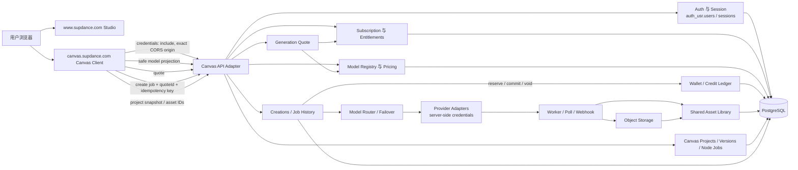

# SupDance Studio × Infinite Canvas 架构

状态：实现中；生产业务能力以 SupDance Next.js 服务为唯一权威。Canvas 是独立部署的创作客户端，不能持有第二套账户、积分、价格、Provider 或对象存储。

## 请求与数据关系

Studio 与 Canvas 使用同一 SupDance API、用户 ID、报价/钱包服务、模型目录、Router、任务表、对象存储与素材服务。Canvas 运行在另一个 HTTPS 域名，但其 API 请求发往 `www.supdance.com`，依赖同站点浏览器 Cookie、`credentials: include` 和精确 Origin CORS。

## 当前生产 API 流程

1. Canvas 启动调用 `GET /api/canvas/session` 与 `GET /api/canvas/models`。Session 端点通过主站 `getUserFromRequest` 获取 `user.id`，权益服务提供余额/订阅摘要；模型接口只投影安全字段。
2. Canvas 调 `POST /api/canvas/quotes`；共享 `createGenerationQuote` 基于主站模型和报价引擎返回服务端积分/成本快照，同时按当时的共享路由策略保存 route snapshot。路由策略变化对新报价立即生效；仍有效的旧报价继续使用其已锁定快照。
3. Canvas 调 `POST /api/canvas/jobs`；验证登录、项目 owner、模型、提示词安全、资产 owner、报价及参数，再以 `studioId: 'canvas'` 调用共享 `createGenerationTask`。生产 schema 的来源标记是 `creations.studio_id`；同一值也传入共享 `reserveCredits`，没有 Canvas 独立 Ledger。该服务在同一事务内消费报价、预留积分、插入 SupDance creation 和事件。
4. Worker/Provider 继续使用共享路由、轮询/Webhook、归档、提交或释放积分与历史记录路径。Worker 路由读取被消费报价中的 route snapshot，因此 Canvas job 请求附带的固定 `routingMode: cost` 不会覆盖后台策略。生产仍会把该固定值写入 creation 摘要/`creations.routing_mode`；候选服务端补丁现在改为记录已校验 quote 的 `routeSnapshot.routingMode`。该修正尚未部署。Canvas 轮询 GET job，并等待耐久 Asset 可读取。服务端 job 接受 image/video/text/audio/music capability；当前生产 Canvas 的音频客户端仍走旧直连 Provider 路径，候选工作副本已改为共享 quote/job/asset 流程，尚未部署与验证。
5. Canvas Projects 使用用户 ID 归属、快照版本、冲突检测与最近 20 个版本；素材上传进入共享私有 Asset 库和对象存储。

## 已知架构缺口

- 当前生产 Canvas job 与 project-node 关联在 `createGenerationTask` 事务提交后另行 INSERT；[候选服务端补丁](./KOYOSIM_CANVAS_SERVER_PATCH.patch)已改为同一事务回调，但未部署。上线后仍要验证冲突回滚与重放不重复扣费。
- Canvas SupDance Shell 已部署；[Studio 导航补丁](./KOYOSIM_STUDIO_NAV_PATCH.patch)按当前生产 `StandaloneShell.js` 重新生成，新鲜快照 apply-check 通过，应用文件与已过 JSX parse 的候选逐字一致；最新生产工作树未做整站构建或浏览器渲染，尚未部署。
- 生产旧 localForage 项目迁移仍缺服务端 source-id 幂等键、备份确认、批量进度与可恢复 UX；客户端和后端相关实现当前只在工作副本/候选补丁。
- 最新生产健康快照（2026-09-29T11:58:56.629Z）仍为 HTTP 503，Provider 状态 unknown；不能从代码存在推导 Provider 实际可用。
- 真实跨账号、跨设备、成功扣费、失败释放、图片/视频/文本终态未验证。
- Image/Video/Text 已有 Server Mode 客户端适配；Audio/Music 的共享任务适配仅在 Canvas 候选工作副本，不能据此声称生产端四类能力完整。
- Canvas 候选在 Job 创建（积分预留后）与终态 Job 读取（capture/release 后）刷新共享 Session 余额，让同一顶部余额显示跟随服务端状态；仅通过候选 typecheck/build，生产 E2E 未验证。

## 权威标识

`auth_usr.users.id` 是 Canvas API 的认证身份、`canvas_projects.owner_user_id`、`creations.user_id` 与 Asset owner 的连接键。生产表定义包含用户外键；真实同一隔离用户端到端相等性尚待 E2E。
