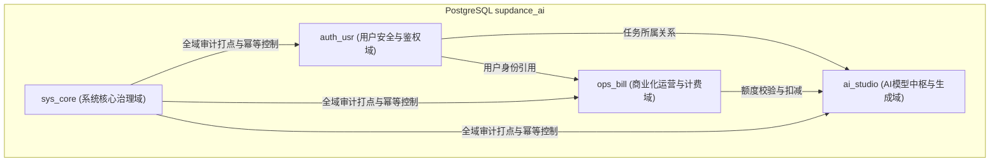

# SupDance AI Studio 数据库架构与开发规范 (PostgreSQL 16)

> **版本**：v2.0.0 (PostgreSQL Native Multi-Schema)  
> **生效环境**：生产环境 / 预发环境 / 本地开发环境  
> **适用对象**：后端开发工程师、系统架构师、DBA、AI 算法工程师

---

## 1. 架构总则与分域治理 (Domain-Driven Schema Design)

为了保障高并发 AI 创作平台的数据隔离性、安全性与扩展性，系统放弃传统单体单公共模式（Single Public Schema），采用 **领域驱动分域架构（Domain-Driven Multi-Schema Architecture）**。全库严密划分为四大核心业务 Schema：



### 1.1 四大业务域划分标准

| Schema 名称 | 业务职责 | 典型数据表 | 敏感等级 |
| :--- | :--- | :--- | :--- |
| **`sys_core`** | 系统治理、环境配置、审计流水、全局幂等性防重、版本迁移 | `system_settings`, `admin_audit_logs`, `idempotency_keys`, `schema_migrations` | **极高** (涉及全平台治理与操作审计) |
| **`auth_usr`** | 统一账户中心、鉴权凭据、安全会话、OAuth 绑定、安全工单 | `users`, `sessions`, `oauth_accounts`, `moderation_cases` | **极高** (涉及用户 PII、密文与凭据) |
| **`ops_bill`** | 商业化会员体系、充值交易、账单流水、额度账本、支付回调 | `plans_config`, `subscriptions`, `orders`, `credit_ledger`, `webhook_events` | **高** (涉及财务、订单与资产对账) |
| **`ai_studio`** | AI 引擎参数、模型定价中枢、任务生成队列、资产流水、渠道健康 | `models_config`, `creations`, `provider_configs`, `provider_health_checks`, `provider_secrets` | **中-高** (高频写入、大文本与任务状态机) |

### 1.2 连接池与 Search Path 透明访问机制
数据库默认与连接池配置：
```sql
ALTER DATABASE supdance_ai SET search_path TO ai_studio, ops_bill, auth_usr, sys_core, public;
```
- **开发原则**：在编写常规业务 SQL 时，上层代码可直接书写 `SELECT * FROM users` 或 `SELECT * FROM models_config`，无需硬编码 Schema 前缀；
- **跨域与冲突保障**：跨域复杂关联或存在同名潜在冲突时，必须显式声明全限定命名，例如 `auth_usr.users` 或 `ops_bill.orders`。

---

## 2. 命名规范与标识符定义

1. **命名风格**：必须全小写，单词间以半角下划线 `_` 分隔（snake_case）。严禁大写或驼峰命名（CamelCase）。
2. **表命名**：
   - 表名使用名词复数（如 `users`, `orders`, `creations`）；
   - 字典表或配置表使用 `_config` 或 `_settings` 后缀（如 `models_config`, `system_settings`）；
   - 关系关联表使用双实体组合（如 `user_tags`）；
   - 日志与流水表使用 `_logs` 或 `_ledger` 后缀（如 `admin_audit_logs`, `credit_ledger`）。
3. **主键与外键命名**：
   - 主键列统一命名为 `id`，严禁 `user_id` 作为 `users` 表主键；
   - 外键列统一命名为 `<被引用实体名单数>_id`（如 `user_id`, `order_id`, `creation_id`）；
   - 外键约束命名：`fk_<本表名>_<目标表名>_<列名>`。
4. **索引命名**：
   - 普通二级索引：`idx_<表名>_<字段1>[_<字段2>]`；
   - 唯一索引：`uq_<表名>_<字段1>[_<字段2>]`；
   - 部分条件索引：`idx_<表名>_<字段>_part`。

---

## 3. 字段类型选型准则 (Data Type Standards)

| 数据语义 | 推荐 PostgreSQL 类型 | 严禁使用 | 架构设计考量 |
| :--- | :--- | :--- | :--- |
| **业务全局主键** | `VARCHAR(64)` 或 `UUID` | 自增 `INTEGER` (单库瓶颈) | 采用带语义前缀的雪花/安全随机串（如 `usr_xxx`, `gen_xxx`, `ord_xxx`），防止被爬虫规律枚举。 |
| **货币与金额** | `BIGINT` (以分为单位) 或 `NUMERIC(12, 4)` | `FLOAT` / `DOUBLE` | 严禁浮点类型！浮点计算存在累积舍入误差。国内法币存分（整数），上游模型按 Token 计费存高精度小数。 |
| **时间与日期** | `TIMESTAMPTZ` (带时区时间戳) | `TIMESTAMP` / `VARCHAR` / 秒级整数 | 必须存储带时区的国际化时间戳，底层存储为 UTC，时区交由应用层按用户展示动态格式化。 |
| **状态枚举** | `VARCHAR(32)` 或 业务约束 CHECK | 难以迁移的自定义 `ENUM` | 原生 Postgres ENUM 变更成本高（ADD VALUE 需锁元数据）；推荐使用标准化字符配合应用层常量或 CHECK 约束。 |
| **非结构化配置** | `JSONB` | `TEXT` / 纯 `JSON` | 必须使用 `JSONB`（二进制存储），支持 GIN 索引、字段级检索与操作符表达式。 |
| **密码与密文** | `VARCHAR(255)` / `TEXT` | 明文存储 | 严禁明文！密码采用 Scrypt / PBKDF2 加盐派生哈希，平台级 API 密钥经 AES-256-GCM 加密存储。 |

---

## 4. 索引设计与查询性能红线

1. **外键必建索引**：所有关联外键字段（如 `sessions.user_id`, `orders.user_id`, `creations.user_id`）必须建立 B-Tree 索引，防止关联删除与多表 JOIN 引发全局锁表与全表扫描。
2. **复合索引最左前缀**：创建联合索引时，将高区分度（High Cardinality）及等值匹配字段置于最左侧，区间查询/排序字段置于后侧。
3. **部分条件索引（Partial Index）优化**：
   - 针对高倾斜状态字段，采用部分索引大幅节省磁盘与内存，如：
   ```sql
   -- 仅针对未完成/挂起的任务构建队列加速索引
   CREATE INDEX idx_creations_pending_queue ON ai_studio.creations(created_at ASC) WHERE status IN ('pending', 'processing');
   ```
4. **覆盖索引避免回表**：在分页聚合高频场景下，利用 `INCLUDE (col1, col2)` 语法将常查字段挂在叶子节点，实现纯 Index-Only Scan。
5. **严禁在索引列上做函数包裹**：如 `WHERE LOWER(email) = ?` 会使 `email` 索引失效，若需大小写无关查询，应构建表达式索引：
   ```sql
   CREATE INDEX idx_users_lower_email ON auth_usr.users(LOWER(email));
   ```

---

## 5. 应用层开发规范与防注入实践

### 5.1 异步与连接池调用原则
应用层统一通过 `lib/db/pg.js` 与 `lib/db/index.js` 与数据库交互：
- **严格异步**：由于 PostgreSQL 驱动 `pg` 为纯异步设计，**所有**数据访问函数必须声明为 `async` 并在调用方显式使用 `await`；
- **连接归还安全**：禁止手动从 Pool 获取连接后遗忘 `release()`，统一使用包装的高阶函数 `query`、`queryOne`、`execute` 或 `withTransaction`。

### 5.2 杜绝 SQL 注入与占位符映射
- **严禁字符串直接拼装 SQL**：严禁 `SELECT * FROM users WHERE id = '` + id + `'`；
- **智能映射支持**：系统底层已内置占位符转换器，既支持 PostgreSQL 原生 `$1, $2` 语法，也完全支持工业兼容的 `?` 占位符转换：
  ```javascript
  // 推荐用法 1：标准化异步查询
  const user = await queryOne('SELECT * FROM users WHERE email = ? AND status = ?', [email, 'active']);
  
  // 推荐用法 2：原生带时区插入
  await execute(`
    INSERT INTO creations (id, user_id, type, prompt, status, created_at, updated_at)
    VALUES (?, ?, ?, ?, ?, now(), now())
  `, [id, userId, type, prompt, 'pending']);
  ```

### 5.3 事务处理与幂等防重红线
- **保持事务精炼**：事务内部**绝对禁止**进行外部 HTTP 请求（如调用 AI 上游推理接口、Stripe 支付网关、发送邮件等网络 IO），事务只应包裹核心数据行锁与跨表一致性变更；
- **利用 `withTransaction` 确保原子性**：
  ```javascript
  await withTransaction(async (tx) => {
    // 1. 悲观行锁锁定用户额度
    const user = await tx.queryOne('SELECT credits FROM users WHERE id = ? FOR UPDATE', [userId]);
    if (user.credits < cost) throw new Error('INSUFFICIENT_CREDITS');
    
    // 2. 扣减额度
    await tx.execute('UPDATE users SET credits = credits - ? WHERE id = ?', [cost, userId]);
    
    // 3. 记录记账流水 (Credit Ledger)
    await tx.execute(`
      INSERT INTO credit_ledger (id, user_id, amount, balance_after, reason, created_at)
      VALUES (?, ?, ?, ?, ?, now())
    `, [ledgerId, userId, -cost, user.credits - cost, 'model_inference']);
  });
  ```
- **核心操作具备幂等键**：所有资金变动、扣点生成、退款与授权操作，必须通过 `checkIdempotency` 校验与 `idempotency_keys` 状态机登记，防止网络抖动导致的重复扣费与重复生成。

---

## 6. 数据迁移与发布流程规范 (Zero-Downtime Migration)

1. **两阶段演进原则（Expand and Contract Pattern）**：
   - **第一阶段（Expand）**：新增列必须允许 `NULL` 或提供合法 `DEFAULT` 默认值，先发布数据库表结构，随后部署新版本应用代码；
   - **第二阶段（Contract）**：当下游与生产应用完全脱离旧字段依赖后，在后续迭代中发布清理旧字段的迁移脚本，严禁一步到位删除或重命名线上使用中的列。
2. **迁移文件管理**：
   - 所有的 DDL 变更脚本必须归档于 `lib/db/migrations/` 目录下；
   - 命名格式为 `00x_<域缩写>_<功能描述>.sql`（如 `002_bill_add_gift_credits.sql`）；
   - 每次执行完毕必须在 `sys_core.schema_migrations` 登记版本号、哈希校验码与应用时间，确保集群升级的可追溯性与确定性。

---

© 2026 SupDance AI Studio Architecture Group. All Rights Reserved.
