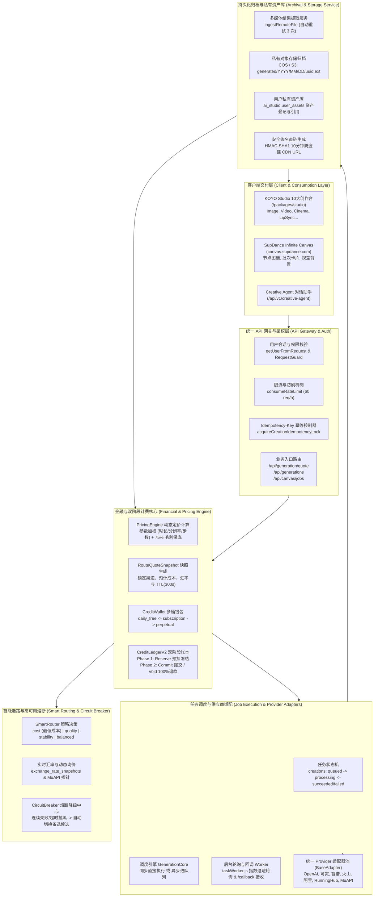
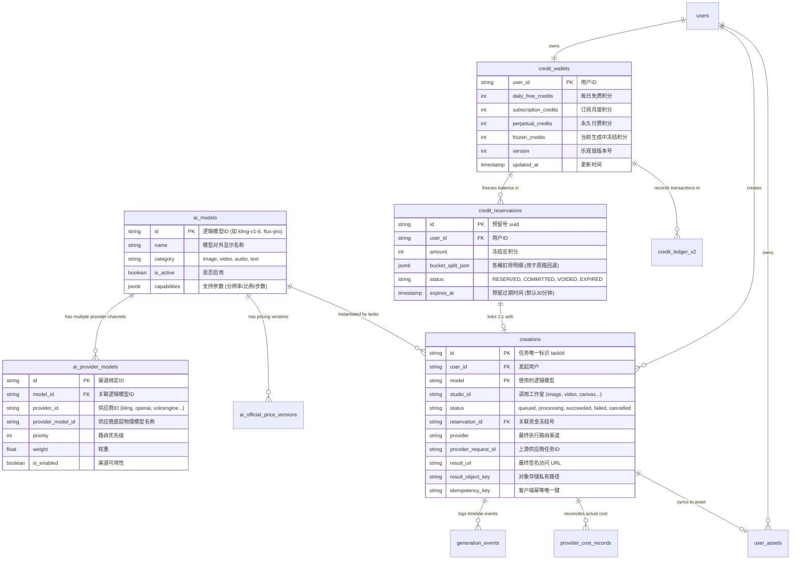
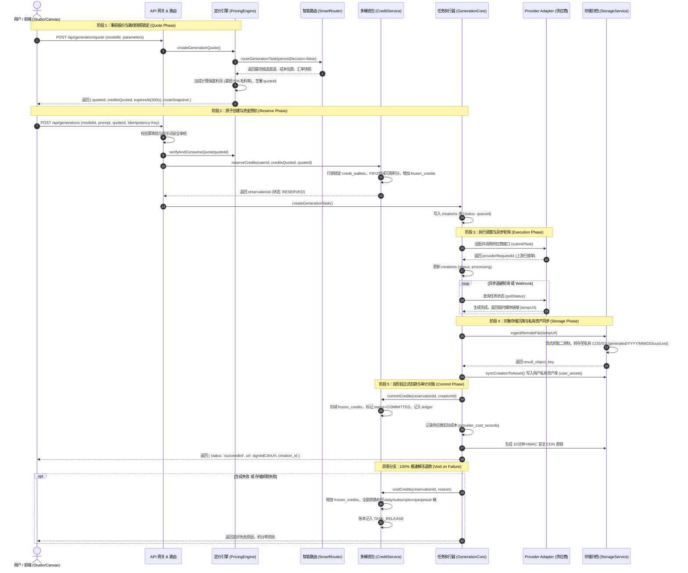

# KOYO Studio / SupDance 大模型全生命周期架构全景规范

> 本规范详细梳理了当前系统中大模型（文本 LLM、图像、视频、音频/音乐）从**接入上架、智能路由、金融结算、任务调度、多媒体归档到端侧交付**的完整端到端运转链路，并为整体架构重构与演进提供标准参考依据。

---

## 1. 架构拓扑全景图 (System Architecture Topology)



---

## 2. 数据库实体关系 (Core Data Models & ERD)



---

## 3. 端到端生成业务时序图 (Full-Lifecycle Execution Flow)



---

## 4. 目录改造对比图 (Modular Monolith)

```text
当前目录结构 (紧耦合单体)                       重构后目录结构 (单体模块化 Modular Monolith)
lib/                                           lib/
├── adapters/                                  ├── ai/                          <--- 统一 AIGC 核心域
│   ├── BaseAdapter.js                         │   ├── contracts/               <--- 核心接口与数据模型 (TS)
│   ├── OpenAIAdapter.js                       │   │   ├── provider.ts          <--- IModelProvider 标准契约
│   ├── VolcengineAdapter.js                   │   │   ├── generation.ts        <--- UnifiedGenerationRequest 规范
│   ├── KlingAdapter.js                        │   │   ├── billing.ts           <--- ITwoPhaseBillingLifecycle 规范
│   └── RunningHubAdapter.js                   │   │   └── realtime.ts          <--- 实时推送事件契约
│                                              │   ├── providers/               <--- 统一 Provider 网关插件池
├── services/                                  │   │   ├── base.provider.ts     <--- 抽象基类 (模板方法模式)
│   ├── generationCore.js (1690行大单体)       │   │   ├── registry.ts          <--- Provider 注册与寻址工厂
│   ├── smartRouter.js                         │   │   └── plugins/             <--- 各厂商沙盒化适配插件
│   ├── pricingEngine.js                       │   │       ├── openai.plugin.ts
│   └── taskWorker.js                          │   │       ├── volcengine.plugin.ts
│                                              │   │       ├── kling.plugin.ts
app/api/                                       │   │       └── runninghub.plugin.ts
│   ├── generations/route.js                   │   ├── billing/                 <--- 两阶段计费与事务状态机
│   └── canvas/jobs/route.js                   │   │   └── twoPhaseSettlement.ts<--- Reserve/Commit/Rollback 闭环
│                                              │   ├── core/                    <--- 新版精简调度管道
│                                              │   │   ├── pipeline.ts          <--- 统摄全链路的 Canonical Pipeline
│                                              │   │   └── smartRouter.ts       <--- 选路与熔断策略中间件
│                                              │   └── queue/                   <--- 异步调度与实时推送
│                                              │       ├── taskDispatcher.ts    <--- 任务异步派发器
│                                              │       ├── asyncWorker.ts       <--- 后台退避轮询与超时管理
│                                              │       └── realtimeEmitter.ts   <--- SSE 事件流推送中枢
│                                              app/api/
│                                              ├── generations/route.ts         <--- 变更为薄包装 (转调 Unified Pipeline)
│                                              ├── canvas/jobs/route.ts         <--- 变更为薄包装 (转调 Unified Pipeline)
│                                              └── generations/events/route.ts  <--- 新增: SSE 客户端实时事件订阅流
```
