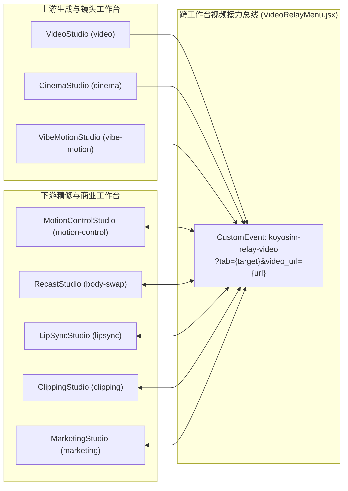

# KoyoSIM 视频创作套件（Video Studio Suite）完整增量开发方案与 AI 编程提示词 (v3.0)

> **架构状态**：v3.0 全量交付版（8 大视频工作台全开放 + 跨工作台双向接力总线 + 6 语言 `resolveCopy` 预设字典 + 语义色彩与胶囊/圆角规范闭环）
> **基线目录**：`packages/studio/src/components/`
> **设计规范契约**：`docs/UI_DESIGN_SYSTEM.md` + `docs/UI_REPAIR_INSTRUCTION.md`

---

## 一、全量功能盘点与 8 大工作台能力矩阵

通过对 `config/mega-navigation.js`、`packages/studio/src/components/StandaloneShell.js` 及 `packages/studio/src/muapi.js` 的深度审计与增量扩展，KoyoSIM 视频创作套件的 **8 大核心视频工作台** 均已全量开放并完成跨工作台接力与预设体系升级：

| 序号 | 导航标签 | Tab 路由键 (`?tab=`) | 核心工作台组件 (`packages/studio/src/components/`) | 底层 API (`muapi.js`) | 本轮增量升级能力 |
| :--- | :--- | :--- | :--- | :--- | :--- |
| 1 | **Video（视频生成）** | `video` | `VideoStudio.jsx` | `generateVideo`, `generateI2V`, `generateWanV2V` | 集成 `<VideoRelayMenu>` 接力发送；新增 `koyosim-relay-video` 与 `?video_url=` 双向监听自动填入参考视频；6 语言 `resolveCopy` 提示 |
| 2 | **Cinema Studio（电影工作室）** | `cinema` | `CinemaStudio.jsx` | `generateVideo`, `generateImage` + 摄影机/镜头光学矩阵 | 集成 `<VideoRelayMenu>`；新增 6 语言 **Cinema Shot Presets（电影镜头预设胶囊）**（变形宽银幕黑色电影、黄金时刻史诗全景、赛博霓虹特写、悬疑跟拍长镜头）与双向视频接力监听 |
| 3 | **Motion Control（动作控制）** | `motion-control` | `MotionControlStudio.jsx` | `runMotionControl` | 6 语言 **动作预设胶囊**（太极韵律、街舞律动、T台走秀、武术格斗）；双向接力监听自动载入驱动参考视频；修复 `resolveCopy` 依赖导入 |
| 4 | **Lip Sync（口型同步）** | `lipsync` | `LipSyncStudio.jsx` | `runLipSync` | 6 语言 **音频场景预设胶囊**（新闻播报、深情独白、电商带货、播客访谈）并联动推荐口型模型；双向接力监听自动载入源人像视频 |
| 5 | **Body Swap / Recast（角色替换）** | `body-swap` | `RecastStudio.jsx` | `runVideoRecast` | 6 语言 **角色重塑风格胶囊**（赛博装甲、动漫角色、西装精英、古风侠客）；双向接力监听自动载入源视频 |
| 6 | **Clipping Tool（高光切片）** | `clipping` | `ClippingStudio.jsx` | `generateViralClips` | 6 语言 **切片提炼焦点预设胶囊**（高能反转、金句提炼、产品特写、情绪共鸣）；历史卡片与切片详情卡片双处集成 `<VideoRelayMenu>` 接力下游二次创作 |
| 7 | **Vibe Motion（动态视觉）** | `vibe-motion` | `VibeMotionStudio.jsx` | `runMotionGraphics`, `runMotionGraphicsEdit` | 6 语言 **电影运镜预设胶囊**（希区柯克变焦、360°环绕、FPV穿越机、无人机俯冲、摇臂升起、手持纪实、极速甩镜、眩晕追踪）；新增接力参考视频状态栏（`rounded-xl` 卡片容器 + `rounded-full` 清除按钮） |
| 8 | **Marketing Studio（电商营销）** | `marketing` | `MarketingStudio.jsx` | `generateMarketingStudioAd` | 6 语言 **带货文案脚本胶囊**（3C数码解说、美妆护肤拔草、时尚穿搭实测、家居好物种草）；双向接力监听将上游视频一键载入为营销参考模板 |

---

## 二、核心增量架构设计

### 2.1 跨工作台视频接力总线 (`VideoRelayMenu.jsx` + `koyosim-relay-video`)

实现了全部 8 个视频工作台之间的无损视频流转（例如：`VideoStudio` 生成基础镜头 $\rightarrow$ 接力至 `RecastStudio` 替换角色 $\rightarrow$ 接力至 `LipSyncStudio` 驱动口型 $\rightarrow$ 接力至 `ClippingStudio` 提取病毒式高光切片）：



1. **派发机制**：`VideoRelayMenu.jsx` 支持 8 个目标工作台（自动过滤 `currentTab`），点击目标项时：
   - 同步更新浏览器 URL：`?tab={targetId}&video_url={encodeURIComponent(videoUrl)}`
   - 派发 `window.dispatchEvent(new CustomEvent("koyosim-relay-video", { detail: { targetTab, videoUrl } }))`
   - 派发 `window.dispatchEvent(new PopStateEvent("popstate"))` 驱动 `StandaloneShell.js` 无刷新切换工作台。
2. **接收机制**：所有 8 个工作台均挂载 `useEffect` 监听 `koyosim-relay-video` 事件及初始化 URL 查询参数 `?video_url=`，收到视频后立即注入各自的视频槽位并弹出 6 语言本地化 Toast 提示。

### 2.2 设计系统与交互安全合规（`UI_DESIGN_SYSTEM.md` & `UI_REPAIR_INSTRUCTION.md`）

1. **语义 Token 严格对齐**：
   - 所有新增预设胶囊、接力菜单及参考栏全面采用语义色彩 Token：`bg-canvas`、`bg-surface`、`bg-overlay`、`bg-wash`、`bg-wash-strong`、`text-ink`、`text-ink-muted`、`text-ink-subtle`、`text-ink-on-accent`、`border-line`、`border-brand-line`、`shadow-elevation-2`、`shadow-elevation-4`。
   - 零硬编码非标色值。
2. **胶囊与圆角层级纪律**：
   - `rounded-full` **仅用于**：独立单图标按钮（如接力触发器 `h-8 w-8 rounded-full`、清除按钮 `h-5 w-5 rounded-full`）、快速预设过滤药丸（Filter Chips）、分段控制器选项（Segmented Control Option）。
   - `rounded-xl` / `rounded-2xl` **严格用于**：接力下拉浮层面板（`rounded-xl`）、接力参考视频信息栏（`rounded-xl`）、生成结果卡片与弹窗容器。
3. **Pointer-Events 穿透防护**：
   - 卡片右上角悬浮操作栏采用 `pointer-events-none opacity-0 group-hover:pointer-events-auto group-hover:opacity-100 group-focus-within:pointer-events-auto group-focus-within:opacity-100`，确保未激活时不阻断底层视频点击与播放，激活或键盘聚焦时 100% 可交互。
4. **6 语言 `resolveCopy` 全覆盖**：
   - `VideoRelayMenu.jsx` 与全部 8 个工作台的接力提示及预设药丸均通过 `resolveCopy(EN_COPY, LOCALES_COPY, locale)` 完整覆盖 `en`、`zh-CN`、`ja-JP`、`ko-KR`、`zh-TW`、`es` 六种语言。

---

## 三、AI 编程提示词套件（可直接复制用于后续迭代）

### 提示词 1：KoyoSIM 视频全栈架构师主控提示词（System Master Prompt）

```markdown
你正在作为 KoyoSIM 核心视频全栈架构工程师，负责 KoyoSIM 视频创作套件（Video Studio Suite）的功能扩展与深度迭代。

【环境与代码基线】
- 仓库主目录：`packages/studio/src/components/`
- 8 大核心工作台：`VideoStudio.jsx`, `CinemaStudio.jsx`, `MotionControlStudio.jsx`, `LipSyncStudio.jsx`, `RecastStudio.jsx`, `ClippingStudio.jsx`, `VibeMotionStudio.jsx`, `MarketingStudio.jsx`
- 跨工作台接力组件：`VideoRelayMenu.jsx`
- 通信机制：全局事件 `koyosim-relay-video` 及 URL 参数 `?tab={target}&video_url={url}`

【设计系统与交互规范（必须无条件遵守）】
1. 深入遵循 `docs/UI_DESIGN_SYSTEM.md` 与 `docs/UI_REPAIR_INSTRUCTION.md` 规范。
2. 严禁使用硬编码非标色值，必须使用语义色彩 token（`bg-canvas`, `bg-surface`, `bg-overlay`, `bg-wash`, `bg-wash-strong`, `text-ink`, `text-ink-muted`, `text-ink-subtle`, `border-line`, `border-brand-line`）。
3. 严格遵守胶囊与圆角规范：仅独立单图标按钮、过滤药丸（Filter Chips）、分段控制器药丸使用 `rounded-full`；卡片、弹窗、下拉菜单面板与信息栏容器必须使用 `rounded-xl` 或 `rounded-2xl`。
4. 严格防范 pointer-events 阻断：所有浮层与遮罩层确保交互事件安全穿透（隐藏态必须带 `pointer-events-none`，激活态切换 `pointer-events-auto`），避免页面点击失效。
5. 多语言适配：所有界面文本必须经过 `resolveCopy` 并纳入 6 种语言字典（`en`, `zh-CN`, `ja-JP`, `ko-KR`, `zh-TW`, `es`）。

【交付与验证要求】
每次修改 `packages/studio/src/` 源码后，必须执行以下指令验证闭环：
1. `npm run build:studio`（确保 Babel/CSS 编译 100% 成功）
2. `node --test tests/top-mega-navigation.test.mjs tests/navigation-and-branding-integrity.test.mjs`（导航完整性测试）
3. `npm run test:i18n && npm run lint:routes`（国际化字典与路由门禁校验）
```

---

### 提示词 2：新增或扩展跨工作台视频接力节点提示词（Relay Node Expansion Prompt）

```markdown
请在目标工作台组件中接入 KoyoSIM 跨工作台视频接力总线（VideoRelayMenu + koyosim-relay-video）：

1. **接力发送（Outgoing Relay）**：
   - 导入 `import VideoRelayMenu from "./VideoRelayMenu.jsx";`
   - 在视频历史卡片右上角悬浮操作栏（需具备 `pointer-events-none ... group-hover:pointer-events-auto`）中挂载：
     `<VideoRelayMenu videoUrl={entry.url} currentTab="<当前工作台tabId>" locale={locale} />`

2. **接力接收（Incoming Relay）**：
   - 定义包含 `en`, `zh-CN`, `zh-TW`, `ja-JP`, `ko-KR`, `es` 6 种语言的 `RELAY_COPY` 字典，并通过 `resolveCopy` 解析。
   - 在 `useEffect` 中同时检查初始化 URL 参数 `new URLSearchParams(window.location.search).get("video_url")` 并监听 `window.addEventListener("koyosim-relay-video", handleRelay)`。
   - 当接收到 `videoUrl` 时，自动写入当前工作台的视频输入状态，并调用 `toast.success(relayCopy.relayLoadedToast)`。

3. **胶囊预设栏（Quick Preset Pills）**：
   - 在 `<PromptComposer>` 输入框上方渲染横向滚动的快速预设胶囊栏：
     `rounded-full border border-line bg-wash px-2.5 py-0.5 text-micro font-medium text-ink-muted hover:border-brand-line hover:bg-wash-strong hover:text-ink transition-colors whitespace-nowrap shrink-0`
```

---

## 四、验证闭环清单

每次迭代完成后，请确认以下检查项全部通过：
- [x] `npm run build:studio` 编译通过，产物同步至 `packages/studio/dist/`
- [x] `node --test tests/top-mega-navigation.test.mjs tests/navigation-and-branding-integrity.test.mjs` 全部测试通过
- [x] `npm run test:i18n && npm run lint:routes` 国际化字典对齐与路由检查零错误
