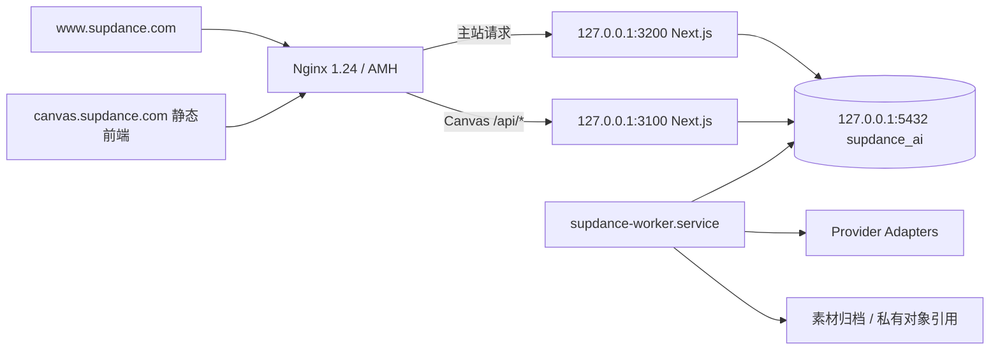

# SupDance V4 双站生产只读审计

审计日期：2026-10-29（Asia/Taipei）。主要证据采集窗口：10:12–10:21；10:27:47 最后复核版本与服务。服务器：`43.133.253.76`，主机：`VM-0-15-ubuntu`。

本报告修订 ChatGPT 对话「分支 · AI编程工具建议」中的 V4.0：此前仅有仓库核查，本次已经读取实际生产源码、构建产物、Nginx 配置、进程环境与 PostgreSQL 只读聚合。所有结论仅对应本次快照。

本次没有修改生产代码、配置、数据库、用户积分、密钥或服务；没有构建、部署、重启、执行 Worker、调用供应商探针或提交生成/报价请求。数据库查询均使用 `BEGIN READ ONLY`，设置局部查询超时后 `ROLLBACK`。仅对本机两个上游执行了未登录模型/配置 GET，均返回 401。没有获得登录态接口完整响应，也没有执行付费生成。

## 1. 执行摘要

双站已经共用 Next.js 业务内核和同一数据库，无需新建 Canvas 商业后端或第二套钱包。主要工作应是保护现有事务内核、审查本地已有修复、补齐协议并分批发布。

| 编号 | 优先级 | 已证实事实及影响 | 验证边界 |
|---|---|---|---|
| F01 | P0 | 生产预扣 TTL 为 15 分钟；到期清理不检查关联任务；视频轮询允许 30 分钟。超过 15 分钟仍执行的视频可能被解冻，后续提交结算失败 | 已确认运行 Worker 的源码路径；未在生产制造此场景，快照无未结预扣 |
| F02 | P0 | 已受理任务的快轮询异常仍进入通用故障转移；轮询总时限到达后直接失败并退款。执行结果未知与明确失败没有完整分开 | 源码确认；未证明历史上发生重复供应商收费 |
| F03 | P0 | 主站生产模型接口没有 V2 响应版本与能力版本绑定；Canvas 线上仍为旧版 `9e7ec42`，远端 `c16ae68` 的新客户端未上线 | 生产源文件、编译路由、实际引用的前端 bundle 互相印证；登录态响应未采集 |
| F04 | P1 | 118 条成本记录全部待对账，实际成本均为空；71 个成功任务中有 2 个历史任务缺成本记录，共 4 积分 | 数据确认；不得宣称已核算真实毛利 |
| F05 | P1 | 报价按 ¥0.07/积分；后台估值默认 $0.01/积分 × 7.23 = ¥0.0723；数据库最新成本汇率为 6.7147，旧纯成本函数仍使用 7.2 | 代码及报价快照确认；不能把不同含义的口径直接改成同一个数字 |
| F06 | P1 | 火山、可灵、MiniMax、阿里等探针可仅凭密钥非空报告 healthy；运行配置又允许健康记录最长 24 小时 | 适配器源码与进程环境确认；healthy 不等于上游鉴权、权限或生成已验收 |
| F07 | P1 | 火山和 RunningHub 的运行密钥由非空环境变量优先提供；后台加密配置并非总能覆盖环境值 | 配置存在状态及读取顺序确认；未解密、未比较或验证密钥内容 |
| F08 | P1 | `CANVAS_E2E_VERIFIED_MODEL_IDS=*` 绕过逐模型验收名单；音乐仍在 audio 挂载，部分挂载项无启用线路或缺端点/价格 | 数据与代码确认；挂载不等于可执行 |
| F09 | P1 | 主站生产有 431 个 tracked 改动和 174 个未跟踪项；本地相关文件也已修改，不能按 HEAD 覆盖上线 | 文件哈希、Git 状态确认；已有本地修复应先审查复用 |
| F10 | P1 | 主站拒绝 `/uploads/generated/`，Canvas 的 `/uploads/` 别名没有相同拒绝规则 | 配置差异确认；未枚举实际文件或证明存在匿名资产泄露 |

没有发现：负钱包、冻结额与 RESERVED 金额不一致、重复任务幂等键、失败任务已提交扣款、预扣与任务归属/金额/双向链接不一致。上述结论是只读数据检查结果，不能代替并发或故障注入测试。

## 2. 生产拓扑与版本

| 组件 | 实际状态 |
|---|---|
| 主站源码 | `/home/wwwroot/AI/domain/supdance.com/web`，HEAD `da2a3ac2239e998269c653fe14c7b262ad912682`，工作树不干净 |
| 主站构建 | `.next/BUILD_ID = JeOhaUZ7Yliwp74ynIipW`；部分编译路由包含开发机 staging 源路径，不能认定由生产 HEAD 可复现构建 |
| 主站进程 | `supdance.service`，`npm run start -- --hostname 127.0.0.1 --port 3200`；Next 子进程 PID 1214787 |
| Canvas API | `canvas-supdance.service`，同一源码与 `.next`，端口 3100；Next 子进程 PID 1214779 |
| 环境文件 | 两站与 Worker 均引用 `/etc/supdance.env`；实际进程均连 `127.0.0.1:5432/supdance_ai` |
| Canvas 前端 | `/home/wwwroot/AI/domain/canvas.supdance.com/web`，静态发布标记 `d09-05-9e7ec42` |
| Canvas 实际入口 JS | `/assets/index-B16DINPy.js`，SHA-256 `83a26957abca283fcf9fd26824b5cad8a3c104bf4f39396d30dc0a77b942e580` |
| Canvas index | SHA-256 `2678609afb0ca1cd493f2d61577b961da68a64b285d2b5c40c532d8bc3ff6b34` |
| Worker | `supdance-worker.service` → supervisor → `node --experimental-loader ./scripts/server-only-loader.mjs scripts/generation-worker.mjs` → `runGenerationWorkerOnce`；PID 1214748，采样心跳年龄约 1.7 秒 |
| 数据库 | PostgreSQL 16.13；最近记录包含 `078_canvas_project_assets`。迁移存在分支式编号，不能只用整数 78 代替完整迁移清单与校验和 |
| 其他实例 | 3299 是 candidate；3298 的进程工作目录已被删除。Nginx 双站配置未指向它们，不当作生产 |
| 支付开关 | 两站进程 `PUBLIC_PAID_CHECKOUT_ENABLED=false`、`PAYMENT_PILOT_ENABLED=false`；这不证明旧订单、其他支付通路或历史履约均已验证 |

Nginx 主进程 executable 为 `/usr/local/nginx-1.24/sbin/nginx`；只读 `-T` 成功并包含双站 vhost。此操作确认磁盘配置可解析，没有 reload，也不能独立证明内存中每条规则的最近加载时间。

`one.supdance.com` 是同机另一套应用，实际 web/backend Compose 工作目录已为 `/opt/y-supdance-canvas`，镜像标签为 v1.7.1。它不属于本次「主站 + canvas.supdance.com」双站重构，不将其 Go 后端、容器数据库、钱包或更新器混入本项目。

### 本地 / GitHub 对照

| 范围 | 本次读到的版本 | 状态 |
|---|---|---|
| 主站本地 `/Users/seelucency/Documents/dev/Supdance Pro` | `b5eac14978fdaf12ccb631d29d18a57cf4d99a2e`，main | 审计开始时 100 个 tracked 改动、54 个未跟踪项 |
| 主站 GitHub origin/main | `0d673964dea005fae5d64439c1c9971f86243931` | 通过 `git ls-remote` 读取；没有拉取或推送 |
| Canvas 本地与 GitHub | `c16ae68a4951714346a5434fd2b107c65b79d5c6`，`koyo-canvas-ui-i18n` | 本地干净；远端仅这一分支 |
| Canvas 安全 worktree | `95ce5c0b6a68dcdda2fc408b1c09285fee6a2b4f` | 本地干净，是较早独立分支，不作为最新生产基线 |

六个抽查的核心文件（模型接口、generationCore、pricingEngine、providerSecrets、creditService、creditPolicy）本地与生产哈希全部不同。特别是本地已经存在 V2 模型输出、凭据来源状态、仅清理未绑定任务预扣、未知结果待对账等实现。本次仅静态识别，未确认其全部测试、提交及发布状态；后续应审查这些已有改动，不能重复开发或整树覆盖生产。

## 3. 模型目录、协议与实际线路

### 3.1 V2 状态

生产 `app/api/canvas/models/route.js:79` 不读取 `schemaVersion` 查询参数，响应仅 `{ models }`；`publicModel` 输出 inputSchema 等旧字段，没有 schemaVersion / catalogVersion / capabilityVersion。`app/api/canvas/config/route.js:24` 仍按 image/video/text/audio 投影。

编译的 models 路由同样没有版本字段，包含旧 `inputSchema` / `supportedRatios` 投影。整个 server bundle 的其他模块有 capabilityVersion 消费逻辑，不能把“全目录里找到这个字符串”当作此接口已经支持 V2。

线上 Canvas 实际入口 bundle 请求 `/api/canvas/models`，没有 `schemaVersion=2`、capabilityVersion；发布标记对应的 Git 源码在 server mode 仅开放 image。最新本地 Canvas 则请求 V2，包含五种模态与 capabilityVersion 传递。

结论：旧生产前后端仍处于旧契约；新客户端部署前必须先完成服务端版本化契约。未登录 GET 401 只证实认证闸门，不能声称已经取得登录后的 V2 响应。

### 3.2 当前目录与挂载

规范模型共 984 条，active 共 53 条，其中可见 active 11 条：image 4、video 2、audio 4、text 1；没有独立 music 类别记录。

数据库挂载为：

| 分类 | 挂载 ID | 重要配置事实 |
|---|---|---|
| image | seedream-5.0、seedream-4.5、seedream-5.0-edit、gpt-image | seedream 两个基础模型有多家线路；gpt-image 唯一启用映射的 provider_endpoint 为空；seedream-5.0-edit 未查到启用映射 |
| video | kling-3.0、infinitetalk | kling-3.0 有 RunningHub 的 t2v/i2v 映射；infinitetalk 的启用映射依赖已禁用 MuAPI |
| audio | minimax-voice-clone、minimax-music-3.0、suno-v4、suno-v3.5 | 两个 minimax ID 未查到启用映射；Suno 的启用映射依赖已禁用 MuAPI；音乐记录 category 为 audio |
| text | deepseek-v3 | 启用映射指向 BytePlus 的 deepseek-v3，未查到有效 active 成本价格版本；并非仅凭 DeepSeek 官方凭据存在就能使用 |

该表描述数据库配置，不是经过路由过滤后的用户可见目录，也不是可用性证明。11 条挂载模型的 `capabilities.input_schema` 未配置；这只检查了此字段，不能推断所有其他元数据字段均不存在。

`getCanvasAllowedModelIds` 仍会过滤候选与挂载；但运行环境中的 `CANVAS_E2E_VERIFIED_MODEL_IDS=*` 使逐模型验收名单失去限制作用。V4 应以具体能力、具体规格和证据状态管理发布，不能把此通配值解释成所有模型已验收。

### 3.3 路由实际策略

保留 `smartRouter` → `evaluateRouteCandidates`：已有模型一致性、启用状态、审核、端点、规格、适配器、凭据、熔断、健康有效期、并发、配额、成本版本、报价候选与映射版本检查，并记录路由日志及失败候选。

数据库策略为 balanced 944、cost 34、priority 3。实际选择函数显式处理 cost，其余按权重；priority 没有单独的明确分支，应在隔离测试中确认存量 priority 的含义，不能宣称全站统一为最低成本或 RunningHub 固定主路由。

报价内核以可报价候选中的较高成本及毛利底线限制备用预算，执行再按报价候选与映射/价格版本检查。该机制应保留；对不同模型 ID 的备用必须明确能力和报价兼容，不默认跨模型替换。

## 4. 凭据与健康诊断

只读取进程变量是否非空、加密记录是否存在、数据库最新探针状态；没有输出/保存明文、密文、指纹、Cookie、访问签名 URL，也没有主动调用供应商。

| Provider | 执行凭据来源证据 | 当前健康标签 | 可证明的上限 |
|---|---|---|---|
| runninghub | 非空 RUNNINGHUB_API_KEY 优先；本次未查到 ops_bill 对应 api_key | degraded | 已保存的账户探针未达 healthy；余额记录有时间，不能当成即时余额 |
| volcengine | VOLCENGINE_API_KEY 和 ARK_API_KEY 均非空，前者优先 | healthy / credential | 仅检查密钥存在，源码明确未请求上游 |
| alibaba | 环境别名均空；ops_bill 加密 api_key 存在 | healthy | 当前适配器 healthCheck 仅检查密钥非空 |
| kling | 环境别名空；加密 api_key 存在 | healthy | 同上 |
| minimax | 环境别名空；加密 api_key 存在 | healthy | 同上 |
| byteplus | 环境变量空；加密 api_key 存在 | healthy / http | 已保存模型列表探针成功；不证明特定模型有执行权限 |
| deepseek | 环境变量空；加密 api_key 存在 | healthy | 已保存模型列表探针；挂载 deepseek-v3 实际指向 BytePlus |
| google / openai | 环境变量空；加密 api_key 存在 | healthy | 已保存模型列表探针；不证明生成及结算 |
| muapi | 环境空；production/sandbox 加密记录均在，provider 已禁用 | healthy 的旧/其他探针记录 | 不能因此放开线路；已有 11 条 enabled 映射仍被 provider 禁用拦住 |

`providerSecrets.js:37` 明确环境变量优先，加密数据库回退。数据库记录存在不等于可解密或有效；本次未解密。进程 `MODEL_HEALTH_MAX_AGE_MS=86400000`，而探针周期为 300000 ms；长时间沿用配置级 healthy 的风险必须在 V4 发布判定中消除。未经证据确认的认证、模型权限和真实生成状态保留 Unknown。

## 5. 计费、积分及对账

### 5.1 已存在的可靠基础

`createGenerationTask` 在同一事务中取得用户幂等锁、再次查重、校验并消费报价、预扣积分、创建任务、链接预扣、写事件并执行 Canvas 项目关联回调。预扣有钱包行锁，扣减顺序为每日免费 → 订阅 → 永久积分。

成功路径将任务终态、私有素材、预扣提交、供应商成本记录与事件放入事务。数据库还存在 creations 用户幂等唯一索引、reservation 唯一关联、账本幂等索引及报价幂等索引。TASK_COMMIT 的 delta 为 0 是因为余额已在 TASK_RESERVE 阶段扣减，不应误判成“成功任务没有扣积分”。

`TwoPhaseBillingSettlement.executeWithBilling` 有 catch 全量 rollback 的静态风险，但两条生产入口直接调用 generationCore；pipeline 虽 import 它，未见执行 executeWithBilling。不能把此包装器的注释或设计当作现行生产生成路径。本轮真正的高风险在实际 Worker 的到期清理与未知状态处理。

### 5.2 只读一致性结果

| 检查 | 结果 | 解释 |
|---|---|---|
| 钱包 | 25；原始 daily 20、subscription 0、perpetual 10860、frozen 0 | daily 20 属于两个已过期桶，不是有效可用余额 |
| 负数钱包 | 0 | 未覆盖未来并发情况 |
| 冻结 / RESERVED 差异 | 0 | 当前没有 RESERVED 或逾期 RESERVED |
| 预扣终态 | COMMITTED 71 / 1814 积分；VOIDED 46 / 919 积分 | COMMITTED settled 合计 1814 |
| 预扣归属、金额、链接 | 异常 0 | 未发现孤立预扣、双向关联差异 |
| TASK_RESERVE / TASK_COMMIT 覆盖 | 71 个已提交预扣均有两类流水 | 不等于所有历史入账资金来源已完整回溯 |
| 任务幂等重复 | 0 | 按 user_id + idempotency_key 聚合 |
| 失败任务已 COMMITTED | 0 | 未发现该类现存数据 |
| 旧 users.credits 与原始钱包 | 2 处差异 | 忽略过期 daily 后有效余额差异为 0；不列为已确认余额缺陷 |
| 成功任务 | 71，credit_cost 共 1814 | 本轮没有提交这些任务，它们是历史数据 |
| 成功素材 | 71 个任务均标 ready，均有 object key 与 asset_id | 本轮没有验证所有对象实际存在、签名下载及用户权限 |
| 成本记录 | 118，全部 pending_reconciliation；actual_cost_usd 全空 | 116 条 estimate_only，2 条 cost_source 为空；估算成本不能记作已确认成本 |
| 成功任务成本缺失 | 2，合计 4 积分 | 均为 2026-09-20 的历史 Studio 任务，需要回溯或以有证据的历史缺口标记 |
| 同 attempt 成本重复 | 0 | source 中存储失败多处记成本仍需故障测试，不宣称线上已发生重复记账 |
| Canvas 项目任务缓存状态 | 4 条与 creations 终态不同 | 当前列表查询使用 c.status AS task_status；不能据缓存 queued/processing 推断有 4 个活跃任务 |

### 5.3 需要修复的生命周期风险

F01：`financial/constants.js:56` 的预扣 TTL 15 分钟；`creditService.js:535` 的清理对所有过期 RESERVED 调用 voidCredits。`taskWorker.js` 每轮都会清理。`generationCore.js:1459` 起允许视频轮询 30 分钟。实际 Worker 直接 import 这些生产源文件，风险不依赖网页是否刷新。

F02：`generationCore.js:902` 接受上游任务后持久化 receipt，但随后的快速 getTask 异常会进入 `:1077` 起通用 catch，并可能排除供应商后重试；`:1475` 达到时限时不先取得 Provider 最终失败证据就释放积分。长期轮询的 transient catch 已会继续原任务，这一已有保护应保留；不能将快轮询与长轮询混作同一行为。应分开请求未发送、明确拒绝、已受理执行中、已受理结果未知、明确终态、归档失败与计费待核对。本次没有证据证明历史损失金额。

### 5.4 实际定价口径

生产报价 `creditPolicy.js`：¥0.07/积分、成本准备金 10%、目标/最低毛利率 30%、向上取 5 的倍数、最低 10 积分。公式价按候选上界计算，约为：

`credits = max(minCredits, ceil((costCny × 1.10 / 0.70 / 0.07) / 5) × 5)`

该公式仅描述 formula 路径；固定价、规格和覆盖政策仍需读取对应报价快照，不能当成全站统一售价。

生产 `creditValuation` 默认 $0.01/积分 × 7.23，得到 ¥0.0723；两个 settings 表均没有 credit_valuation 覆盖。最新汇率记录 USD/CNY 为 6.7147（2026-10-29 10:00 观测，reference 类型）。最新历史报价快照记录 ¥0.07、USD/CNY 6.7165；351 个较早报价仍锁定 7.2。

984 条 model_pricing 都标 auto，但 active_site_price_version_id 全空，390 个报价中 site_price_version_id 全空。数据库 pricing_strategy 记录 inactive，不能因 auto 标签或迁移名含 130pricing 就宣称运行已采用统一 1.3 倍定价。

V4 必须分别定义销售积分面值、报表估值、供应商成本汇率及价格版本；历史报价保留其快照。原 V4 的“旧后台 0.1”没有在本次核查的核心路径中确认，应删除该生产缺陷表述，改为以上有证据的多口径问题。

## 6. 身份、素材与部署的证据边界

身份已有共享 ko_session，生产 Secure、HttpOnly、SameSite=Lax，域名按请求推导 `.supdance.com`。Canvas 代理设置 Host 为 www、Origin 为 Canvas，并保留 X-Forwarded-Host；应用有 Origin allowlist、写请求标识及 expectedOwnerUserId 校验。这支持共享身份架构，未替代本轮未做的双账号浏览器验收。

素材数据：179 ready + 2 trash，visibility 均为 private。71 个历史成功生成均有私有对象字段。数据标记不等于存储 ACL 或下载权限已经验收。尤其 Canvas 的 `/uploads/` 静态别名需检查遗留公开文件规则；本轮未枚举用户文件。

当前存在多个 `.next-prev-*` 回滚目录，但没有执行恢复演练或数据库备份校验。本报告和本地源码快照不是数据库备份，也不能作为生产写入前已具备完整回滚能力的证明。

## 7. 证据索引与复查方式

脱敏证据与服务器源码副本保存在本聊天本地审计目录：

`/Users/seelucency/.codex/visualizations/2026/10/29/01a1856d-4e5c-7062-9180-00e1f20ff10f/server-audit/`

| 证据 | 内容 |
|---|---|
| evidence/01-runtime.txt | 进程、环境存在状态、双站 Nginx 原文 |
| evidence/02-source-index.txt | 模型、报价、任务等初始源码带行号摘录 |
| evidence/03-data-baseline.txt | systemd 状态及 Canvas release/config |
| evidence/04-db-schema.txt | 实际多 schema 表结构 |
| evidence/05-db-aggregates.txt | 模型、路由、价格、钱包、账本、任务、成本聚合 |
| evidence/06-runtime-contracts.txt | 核心文件 SHA-256、编译路由哈希、未登录 GET、环境来源 |
| evidence/07-db-controls.txt | 加密记录存在状态、旧余额、成本缺口、唯一索引 |
| evidence/08-worker-and-artifacts.txt | Worker 源码、编译路由片段、实际引用 Canvas 资源 |
| evidence/09-local-comparison.json | 本地三工作区状态及核心文件哈希对照 |
| evidence/10-final-db-checks.txt | 过期余额排除、报价估值、素材与缓存状态 |
| evidence/11-provider-adapters.txt | 实际健康探针实现带行号摘录；其中初次心跳字段查询失败，已在 12 修正 |
| evidence/12-source-routing-summary.txt | 数据库真实连接目标、有效余额比较、挂载线路、心跳 |
| evidence/13-finance-reconciliation.txt | 成本重复、失败结算、预扣双向关联复核 |
| evidence/14-remote-refs-and-canvas-source.txt | 远端引用与旧 Canvas 能力源码 |
| evidence/15-final-runtime-recheck.txt | 10:27:47 复核：HEAD、BUILD_ID、四个核心哈希及 Canvas release 未变，三项服务均 active |
| source/ | 336 个选定生产业务源码/迁移文件副本；不含运行 .env 或数据库内容 |
| V4.0-原文.md | 从 ChatGPT 对话读取的原始 V4 方案副本，保留追溯 |

首轮 public schema 查询无结果，因为真实业务表在 ai_studio / ops_bill / auth_usr / sys_core；后续查询已按实际 schema 修正。失败查询只作为采集记录，不当作缺表结论。

最后一次版本复核未发现上述核心文件或构建版本漂移。后续复查必须重新读取运行 PID、BUILD_ID、源文件哈希、Canvas release 与数据库时间；不得将本报告直接当作将来的当前状态。
